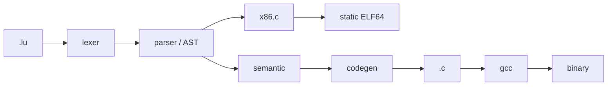

<p align="center">
  
  
  
  
</p>

<h1 align="center">Lu</h1>

<p align="center">
  <strong>Явная типизация. Свой бэкенд x86-64. Никакой скрытой машины.</strong>
</p>

> Lu — компактный компилируемый язык. Вы пишете `.lu` и получаете либо
> статический ELF64 напрямую (свой бэкенд, без gcc), либо читаемый `.c`,
> который собирает обычный C-компилятор. Всё, что делает Lu, видно: либо в
> машинном коде, либо в сгенерированном C.

---

## Содержание

1. [Быстрый старт](#start)
   - [Два бэкенда](#backends)
   - [Длинные явные формы](#long)
   - [Lu v5 — канонический синтаксис](#strict)
   - [`Uios`: потоки ввода-вывода](#uios)
2. [Модель выполнения](#model)
3. [Лексика](#lexis)
4. [Типы и переменные](#types)
5. [Операторы](#ops)
6. [Управление потоком](#control)
7. [Функции](#functions)
8. [Структуры, классы, ООП](#oop)
9. [Коллекции и строки](#collections)
10. [Ошибки и отладка](#errors)
11. [Системные возможности](#system)
12. [Стандартные функции](#stdlib)
13. [Устройство компилятора](#internals)
14. [Сборка и тесты](#testing)
15. [Стиль кода](#style)
16. [Рецепты](#recipes)
17. [Ограничения и FAQ](#limits)
18. [Ссылки](#links)

---

<a id="start"></a>
## 1. Быстрый старт

### Требования

- Linux x86-64 для нативного бэкенда; GCC или Clang с C11 — чтобы собрать
  сам компилятор и работать с `-c`.
- `make` для сборки компилятора.
- Для GUI-примера — X11; для Tensor — только `libm`.

Для `luc -n` gcc не требуется: готовый `src/luc` — единственный инструмент,
нужный для получения исполняемого файла.

### Сборка компилятора

```bash
cd src
make
./luc -v
```

Появится `src/luc`.

С версии 4.1 компилятор умеет два бэкенда:

- **нативный** (`-n`, по умолчанию) — сам пишет статический x86-64 ELF;
  gcc, ассемблер и линкер не участвуют;
- **C** (`-c`) — транслирует `.lu` в `.c` и печатает готовую команду сборки.

### Первая программа

`hello.lu`:

```lu
Lu/Language

fn main() -> int {
    print("Привет, Lu!")
    return 0
}
```

Нативно (gcc не нужен):

```bash
src/luc hello.lu -o hello
./hello
```

Или через C:

```bash
src/luc -c hello.lu -o hello.c
gcc -O2 -std=c11 -o hello hello.c -lm
./hello
```

Вывод в обоих случаях:

```text
Привет, Lu!
```

`Lu/Language` — необязательная строка-маркер. Она ничего не делает, но
показывает, что файл написан на Lu.

### Анатомия файла

```text
Lu/Language              необязательный маркер

Import "<math.h>"        объявления и подключения — на верхнем уровне
const int LIMIT = 100
struct Point { ... }
def helper(...) -> ...   функции — на верхнем уровне

def main() -> void       необязательная точка входа
#q1                      блок исполняемых операторов
...
#q1:end
```

Главное правило: **исполняемые операторы должны находиться внутри `def main`
или внутри блока `#q`**. На верхнем уровне разрешены только объявления.

### CLI

| Команда | Что делает |
|---|---|
| `luc file.lu` | нативный бэкенд: пишет исполняемый ELF рядом с исходником |
| `luc file.lu make` | собирает нативно, запускает и показывает вывод; код возврата — код программы |
| `luc file.lu -o prog` | нативный бэкенд: пишет ELF в `prog` |
| `luc -c file.lu -o out.c` | записывает C-код в `out.c` |
| `luc file.lu -o out.c` | то же самое: суффикс `.c` выбирает C-бэкенд |
| `luc -t file.lu` | печатает поток токенов и выходит |
| `luc -a file.lu` | печатает AST и выходит |
| `luc -s file.lu -o out.c` | печатает статистику этапов в stderr |
| `luc -d file.lu -o out.c` | добавляет отладочную трассировку блоков |
| `luc -O0..-O3 file.lu` | записывает уровень в комментарий C-файла |
| `luc -v` | версия компилятора |
| `luc -h` | краткая справка |

### Режим `make`

`luc file.lu make` — «собери и сразу покажи результат». Компилятор пишет ELF
тем же нативным бэкендом, что и `luc -n`, но во временный файл в `$TMPDIR`
(или `/tmp`), запускает его через `fork`/`execv` и отдаёт программе свои
stdin, stdout и stderr — вывод идёт прямо в терминал.

Код возврата — код возврата самой программы:

```bash
src/luc hello.lu make
echo $?          # то же число, что вернул `return` в main
```

Если программу убил сигнал, `luc` вернёт `128 + номер сигнала`, как шелл.
Временный бинарник удаляется после запуска; с `-o prog` он остаётся на диске
и запускается уже оттуда. `make` всегда использует нативный бэкенд, поэтому
несовместим с `-c` и с `-o что-то.c`.

Флаг `-O` **не оптимизирует код Lu**. Уровень попадает в комментарий
`/* Lu opt level: O2 */`, а реальную оптимизацию выполняет GCC. Это сделано
намеренно: у компилятора нет собственного оптимизатора, и у нативного бэкенда
его тоже нет — генерируется прямолинейный код.

<a id="backends"></a>
### Два бэкенда

| | `-n` (нативный, по умолчанию) | `-c` (C11) |
|---|---|---|
| Результат | статический ELF64 | исходник `.c` |
| Зависимости | только Linux-ядро | gcc (или clang), libc, `-lm` |
| `syscall`/`exit`/`strlen` | прямые `syscall` + свой цикл | libc |
| `print` | `write(2)` напрямую | `printf` |
| `float`, `asm`, `raw` | нет | есть |
| `Unique<T>`, `Vector<T>` | нет | есть |
| X11, GUI, Tensor | нет | есть |
| Многомерные массивы | нет | есть |
| `for x in arr` | только по локальному массиву | по любому массиву |

Когда нужен `-n`:

- маленькие утилиты и демоны, которым не нужен libc;
- эксперименты с кодогенерацией и ELF;
- окружение без компилятора C.

Когда нужен `-c`:

- GUI/X11, Tensor, математика `-lm`;
- шаблоны `Unique<T>`/`Vector<T>`;
- код, который вы хотите прочитать, отладить в gdb и собрать любыми
  флагами.

Выбор бэкенда определяется так: `-n` или `-c` явно; если задан `-o` с
суффиксом `.c` — C-бэкенд; иначе нативный.

Нативный ELF — freestanding: только `PT_LOAD` (код `R|X`, данные `R|W`) и
`PT_GNU_STACK`, без `PT_INTERP` и без `DT_NEEDED`. Точка входа — `_start`,
которая вызывает `__lu_top` (верхнеуровневые инициализации), затем `main`.
Код возврата `main` становится кодом выхода процесса.

Встроенный рантайм нативного бэкенда — `lu_strlen`, `lu_write`, `lu_puts`,
`lu_putc`, `lu_putn`, `lu_memset`, `lu_memcpy`, `lu_alloc`, `lu_free`. Он
написан на самом Lu (строкой-прелюдией) и компилируется тем же парсером в
каждую программу.

<a id="long"></a>
### Длинные явные формы

Короткие формы остались алиасами, но есть полный «низкоуровневый» стиль.
Он и рекомендуется для нового кода.

| Коротко | Длинно | Значение |
|---|---|---|
| `def f(int a) -> int` | `fn f(a: int) -> int` | функция |
| `int x = 1` | `var x: int = 1` | переменная |
| | `let x: int = 1` | то же (`let` = `var`) |
| `struct P { int x }` | `struct P { x: int }` | поле |
| `Loop/3` | `loop 3 { ... }` | ровно 3 итерации |
| | `ptr/byte p` | указатель |
| | `var p: ptr/byte` | указатель длинной формой |
| | `raw { 0x90 }` | сырые байты (только `-c`) |

```lu
Lu/Language

struct Point {
    x: int
    y: int
}

fn add(a: int, b: int) -> int {
    return a + b
}

fn main() -> int {
    var p: Point
    p.x = 20
    p.y = 22

    let total: int = add(p.x, p.y)
    print(total)

    var i: int = 0
    loop 3 {
        i = i + 1
        if i == 2 {
            continue
        }
        print(i)
    }

    return 0
}
```

`var p: ptr/int` — полная форма `ptr/int p`. Обе дают настоящий указатель:
работают `Free/p`, `p[0]`, `p->field` и проверки семантики.

---

<a id="strict"></a>
### Lu v5 — канонический синтаксис

Если первая строка файла — `Lu/Strict`, компилятор читает его по правилам
из [`SYNTAX.md`](SYNTAX.md): тот же низкоуровневый язык, но строже и
короче. Транспайлер `src/v5.c` переводит программу во внутреннее ядро,
поэтому работают оба бэкенда и режим `make`.

```bash
./luc tests/v5/good/01_arith.lu make     # собрать нативно и запустить
./luc tests/v5/good/01_arith.lu -o x.c   # C-бэкенд
```

Правила, которых нет в v4:

| v4 | v5 | Смысл |
|---|---|---|
| `var x: int = 0` | `vid x: int = 0` | `vid` — неизменяемая привязка |
| `x = 1` | `set x = 1` | присваивание только через `set` |
| `def f(a: int) -> int` | `fn f(a: int) -> int` | функции |
| `include <io.h>` | `incl <std/io>` | подключения |
| `print(x)` | `Pr(x)` | вывод |
| `scan(&x)` | `dv(&x)` | ввод, возвращает `bool` |
| `Free/p` | `Del p` | освобождение |
| `i = i + 1` в `loop` | `for i in 0..10` | диапазонный цикл |
| `switch` | `match x { case 1 {...} else {...} }` | выбор |

`struct`-поля по умолчанию приватны, `pub` ставится перед полем. Битовые
поля живут только внутри `pack byte Name { vid0..1 flag: bool }`. Метод —
это `fn` внутри `struct`; `self` объявляется явно и является `ptr/Struct`,
поэтому `set self.hp = ...` меняет объект, а не привязку.

Затенение, запись в `vid`, объявление без типа и неявное сужение
(`int -> byte`) — ошибки компиляции с номером строки исходника v5.
Набор `tests/v5` содержит 12 положительных и 9 отрицательных программ;
проверка — `make test-v5` (каждая положительная собирается ещё и через C,
чтобы оба бэкенда давали одинаковый stdout).

---

<a id="uios"></a>
### `Uios`: потоки ввода-вывода

Библиотека [`include/Uios.lu`](include/Uios.lu) повторяет привычную схему
`<iostream>`: три готовых потока и операторы `<<` / `>>`.

```lu
Lu/Strict

incl <Uios>

fn main() -> int {
    Uout << "x = " << 42 << ", y = " << -7 << Uendl

    var name: byte[64]
    var n: int = Uin.get_line(&name[0], 64)
    Uout << "прочитано " << n << " байт: "
    Uout.put_chars(&name[0])
    Uout << Uendl

    var age: int = 0
    Uin >> age
    Uerr << "возраст " << age << Uendl
    ret 0
}
```

| Поток | fd | Что делает |
|---|---|---|
| `Uout` | 1 | `<< value`, `put_str`, `put_int`, `put_i64`, `put_byte`, `put_bool`, `put_ptr`, `put_bytes(p, n)`, `put_chars(p)`, `flush()` |
| `Uerr` | 2 | то же самое, но в stderr |
| `Uin`  | 0 | `>> var`, `get_line(&buf[0], cap)` |

Вещи, которые полезно знать сразу:

- Методы возвращают `ptr/<свой тип>`, поэтому `Uout << a << b << Uendl`
  собирается в цепочку вызовов. `>>` возвращает поток, но читает в
  переменную: правый операнд обязан быть переменной (`Uin >> n`), выражения
  и литералы не принимаются.
- `put_byte` пишет сам байт, а не его число — удобно для посимвольного
  вывода; `put_ptr` печатает `0x` и десятичный адрес.
- `put_chars(p)` печатает байты до нуля — это способ вывести буфер,
  заполненный `get_line`.
- `get_line` возвращает длину без завершающего нуля, обрезает по `cap - 1` и
  всегда дописывает `0`.
- `__uios_geti` пропускает ведущие пробелы и переводы строк, понимает `-` и
  `+`, останавливается на первом не-цифровом байте (он уже съеден). Конец
  файла даёт `0`.
- Вывод небуферизован (один `<<` — один `write(2)`), поэтому `flush()`
  ничего не делает и оставлен для совместимости с привычкой из C++.
- Потоки не хранят состояния: дескриптор зашит в тип. Это следствие того,
  что `vid`-глобалы неизменяемы, а поле потока менять было бы нельзя.

---

<a id="model"></a>
## 2. Модель выполнения

У программы есть три уровня:

```text
верхний уровень     типы, глобальные переменные, константы, функции
def main()          необязательная основная функция
#q1 ... #qN         блоки исполняемых операторов
```

### `#q`-блоки

Блок начинается строкой `#q1` и заканчивается `#q1:end`. Номер — часть имени,
а не порядок запуска.

```lu
#q1
print("первый блок")
#q1:end

#q2
print("второй блок")
#q2:end
```

Каждый блок превращается в отдельную C-функцию `void _qN(void)`. Блоки
выполняются **в порядке появления в файле**, а не по номерам.

```lu
#q2
print("я выполнюсь первым")
#q2:end

#q1
print("я выполнюсь вторым")
#q1:end
```

Вывод:

```text
я выполнюсь первым
я выполнюсь вторым
```

`#qN:end` можно опустить: следующий `#q` или конец файла закроет блок. Явный
`end` делает структуру понятнее, поэтому в документации он используется всегда.

Строка `#q1:имя` задаёт метку блока. Она нужна старому механизму `Lin`;
для новых программ достаточно `#q1`.

### `def main`

Если объявлена функция `main`, она вызывается **до** всех `#q`-блоков.

```lu
Lu/Language

def main() -> void {
    print("main")
}

#q1
print("block")
#q1:end
```

```text
main
block
```

`main` не принимает аргументов. Аргументы командной строки доступны через
служебные переменные `__luc_argc` и `__luc_argv` (см. [рецепты](#recipes)).

### Почему нельзя писать операторы на верхнем уровне

Такой файл компилятор пропустит, но GCC его не соберёт:

```lu
print("hello")
```

```text
error: expected declaration specifiers or '...' before string constant
```

Потому что оператор попадает в C-файл вне функции. Правильно:

```lu
#q1
print("hello")
#q1:end
```

### Области видимости

- Глобальные переменные и константы видны во всех функциях и блоках.
- Переменные внутри `#q`-блока локальны для этого блока.
- Переменные внутри функции локальны для функции.
- Глобальный инициализатор должен быть константным выражением.

```lu
const int LIMIT = 10
int counter = 0

def next() -> int {
    counter += 1
    return counter
}

#q1
print(next(), next(), LIMIT)
#q1:end
```

---

<a id="lexis"></a>
## 3. Лексика

### Комментарии

```lu
// однострочный комментарий
# тоже однострочный комментарий
/* многострочный
   комментарий */
```

### Идентификаторы

Буквы, цифры и `_`; начинаются с буквы или `_`. Регистр важен: `value` и
`Value` — разные имена. Ключевые слова (`if`, `else`, `while`, `def`, `class`,
`return`, `true`, `false`, `None` и другие) зарезервированы.

### Числа

| Запись | Значение | Тип |
|---|---:|---|
| `42` | 42 | `int` |
| `0x2A` | 42 | `int` |
| `0b101010` | 42 | `int` |
| `0o52` | 42 | `int` |
| `3.14` | 3.14 | `float` |
| `1e-3` | 0.001 | `float` |
| `2.5f` | 2.5 | `float` |

Суффиксов `L`, `u`, `ll` нет. Для 64-битных значений используйте тип `int64`
и обычный литерал.

### Строки

Четыре формы записи:

```lu
"обычная строка"
'тоже строка'
«строка в кавычках-ёлочках»
"""многострочная
строка"""
```

Экранирование:

| Escape | Символ |
|---|---|
| `\n` | перевод строки |
| `\t` | табуляция |
| `\r` | возврат каретки |
| `\\` | обратная косая черта |
| `\"` | двойная кавычка |
| `\'` | одинарная кавычка |
| `\0` | нулевой байт |

Неизвестная escape-последовательность сохраняется как есть. Строковый литерал
ограничен **4096 байтами**. `len()` возвращает длину в байтах UTF-8, а не в
символах:

```lu
#q1
print(len("ёлка"))   // 8: две буквы занимают по два байта
#q1:end
```

### F-строки

```lu
str name = "Lu"
int n = 3
print(f"Привет, {name}! n = {n}, n + 1 = {n + 1}")
print(f"Условие: {n > 2}")
```

Вывод:

```text
Привет, Lu! n = 3, n + 1 = 4
Условие: true
```

Внутри `{...}` допустимо выражение. Спецификаторов формата (`{x:>10}`,
`{x:.2f}`) нет. Чтобы вывести литеральные скобки, удвойте их: `{{` и `}}`.

### Логические значения и `None`

`true`, `false` — булевы литералы. `None` — нулевой указатель:

```lu
ptr/int p = None
if p == None {
    print("пусто")
}
```

### Точка с запятой

Перевод строки разделяет операторы. Точка с запятой тоже допустима как
разделитель:

```lu
int a = 1; int b = 2; print(a + b);
```

---

<a id="types"></a>
## 4. Типы и переменные

Lu статически типизирован. Тип переменной фиксируется при объявлении.

### Основные типы

| Lu | C | Размер | Комментарий |
|---|---|---:|---|
| `int` | `int` | 32 бита | основной целый тип |
| `int64` | `int64_t` | 64 бита | большие целые |
| `float` | `double` | 64 бита | несмотря на имя, это `double` |
| `bool` | `bool` | 1 байт | `true` / `false` |
| `byte` | `uint8_t` | 8 бит | беззнаковый байт |
| `str` | `char *` | указатель | строка C |
| `void` | `void` | — | отсутствие значения |

Служебные типы, которые встречаются в старом коде и рантайме:

| Lu | C | Назначение |
|---|---|---|
| `ip` | `lu_ip_t` | адрес и порт |
| `id` | `char *` | идентификатор |
| `cor` | `lu_cor_t` | список целых |
| `msg` | `lu_msg_t` | буфер сообщения |
| `lib` | `void *` | дескриптор библиотеки |

### Объявление

Одна переменная — одна строка. Несколько деклараторов через запятую не
поддерживаются:

```lu
int a = 1
int b = 2
```

Такой код неверен:

```lu
int a = 1, b = 2   // b не будет объявлена
```

### Вывод типа: `auto`

`auto` выводит тип из инициализатора:

```lu
auto n = 41          // int
auto x = 2.5         // float
auto s = "текст"     // str
auto p = new Node(1) // Node*
```

`Auto` с большой буквы — не тип. После вывода тип не меняется.

### Константы

```lu
const int LIMIT = 7
const str NAME = "Lu"
```

Присваивание константе не проходит проверку C-компилятора: в сгенерированном
коде это `const`, поэтому `gcc` сообщает об ошибке.

### Приведение и `sizeof`

```lu
float x = 3.9
int n = (int)x          // 3, усечение к нулю
byte b = (byte)65
print(sizeof(int))      // 4
print(sizeof(x))        // 8
```

`sizeof` работает и для типа, и для выражения.

### Перечисления

```lu
enum Color {
    RED,
    GREEN = 5,
    BLUE
}

#q1
Color c = GREEN
if c == GREEN {
    print((int)c)   // 5
}
#q1:end
```

Значения: `RED = 0`, `GREEN = 5`, `BLUE = 6`.

Два важных ограничения:

- `Color.GREEN` **не работает**. Пишите `Color_GREEN` или просто `GREEN`.
- Печать перечисления напрямую (`print(GREEN)`) не форматируется как число.
  Приводите к `int`: `print((int)GREEN)`.

### Массивы

```lu
int xs[4] = {10, 20, 30, 40}
int m[2][2] = {{1, 2}, {3, 4}}
```

Доступ по индексу, проверки границ нет:

```lu
#q1
int xs[3] = {10, 20, 30}
print(xs[0], xs[2])
xs[1] = 99
print(xs[1])
print(sizeof(xs) / sizeof(int))   // 3
#q1:end
```

Локальный массив без инициализатора не обнуляется. Глобальный — обнуляется
средой C.

### Указатели

```lu
int x = 7
ptr/int p = &x

print(*p)      // чтение: 7
p[0] = 9       // запись: x стал 9
print(x)       // 9
```

Арифметика указателей:

```lu
#q1
int xs[3] = {10, 20, 30}
ptr/int q = xs
q += 2
print(*q, q - xs)   // 30 2
#q1:end
```

Указатели на структуры и классы:

```lu
ptr/Point p = ...
print(p->x)
p->y = 5
```

Чтение через `*p` работает. **Запись `*p = value` в v4.0 не работает**:
кодогенератор ошибочно трактует её как присваивание самому указателю.
Используйте `p[0] = value`.

`None` — корректный нулевой указатель:

```lu
ptr/int p = None
if p == None { print("null") }
```

### Память

```lu
ptr/int p = new int(42)
print(*p)
free(p)
```

`new` выделяет память в куче, если результат присваивается указателю. Если
результат присваивается значению, создаётся значение:

```lu
Vec2 a = new Vec2(1, 2)        // значение
ptr/Vec2 p = new Vec2(3, 4)    // куча
auto q = new Vec2(5, 6)        // Vec2*
free(p)
free(q)
```

`Unique<T>` освобождает объект автоматически при выходе из области видимости:

```lu
#q1
Unique<int> u = new int(7)
print(*u)
#q1:end
```

`Shared<T>` в v4.0 не компилируется; используйте `Unique` или ручной `free`.

---

<a id="ops"></a>
## 5. Операторы

### Приоритет

От высокого к низкому:

| Уровень | Операторы |
|---:|---|
| 12 | `**` |
| 11 | `*` `/` `%` |
| 10 | `+` `-` |
| 9 | `<<` `>>` `>>>` |
| 8 | `<` `<=` `>` `>=` `in` |
| 7 | `==` `!=` |
| 6 | `&` |
| 5 | `^` |
| 4 | `\|` |
| 3 | `and` (`&&`) |
| 2 | `or` (`\|\|`) |
| 1 | `?:` |

Все бинарные операторы левоассоциативны, включая `**`:

```lu
print(2 ** 3 ** 2)   // 64, а не 512
```

Сложные выражения лучше явно группировать скобками.

### Арифметика

```lu
#q1
print(7 / 2)      // 3, целочисленное деление усекает
print(7 % 2)      // 1
print(7.0 / 2)    // 3.5
print(2 ** 10)    // 1024
#q1:end
```

`float` — это `double`, поэтому `7.0 / 2` даёт `3.5`.

### Сравнения и логика

`==`, `!=`, `<`, `<=`, `>`, `>=`, `and`, `or`, `not`.

```lu
if x > 0 and not done {
    ...
}
```

### `in`

Для строк `in` проверяет подстроку:

```lu
#q1
str s = "lu language"
print("lang" in s)   // true
#q1:end
```

### Побитовые операции

`&`, `|`, `^`, `<<`, `>>`, `>>>` (беззнаковый сдвиг вправо).

### Составное присваивание

`+=`, `-=`, `*=`, `/=`, `%=`, `&=`, `|=`, `^=`, `<<=`, `>>=`.

### Тернарный оператор

```lu
str label = n > 0 ? "plus" : "minus"
```

### Конкатенация строк

`+` соединяет строки и автоматически приводит числа и `bool`:

```lu
#q1
str name = "Lu"
print("Привет, " + name + "! n=" + 2)
#q1:end
```

```text
Привет, Lu! n=2
```

Результат конкатенации — новая строка в куче. Литералы освобождать нельзя;
строки, полученные из `read_file`, `upper`, `lower`, `replace`, `input` и
конкатенации, можно освобождать через `free`.

---

<a id="control"></a>
## 6. Управление потоком

### `if` / `else`

Тело обязательно в фигурных скобках. Условие — без обязательных скобок.

```lu
if x > 0 {
    print("positive")
} else if x == 0 {
    print("zero")
} else {
    print("negative")
}
```

Если фигурных скобок нет, тело считается пустым. Цепочка `else if`
компилируется в вложенный `if` внутри `else` — сколько угодно звеньев,
`else` привязывается к ближайшему незакрытому `if` (в v4.0–v4.5 это было
сломано: ветки становились двумя независимыми `if`).

### `while`

```lu
int i = 0
while i < 3 {
    print(i)
    i += 1
}
```

`break` и `continue` поддерживаются.

### `loop N`

`loop N { ... }` — ровно `N` итераций без счётчика в вашем коде:

```lu
loop 3 {
    print("tick")
}
```

`continue` в `loop` всё равно продвигает счётчик (иначе получился бы
бесконечный цикл); `break` выходит сразу.

### `for` / `in`

C-подобного `for (init; cond; inc)` нет. Есть обход:

```lu
for i in range(3) {
    print(i)          // 0, 1, 2
}

int xs[3] = {10, 20, 30}
for v in xs {
    print(v)
}

for v in [4, 5, 6] {
    print(v)
}
```

`range(n)` всегда начинается с нуля. `Vector<T>` через `for ... in` **не
обходится**; используйте индекс:

```lu
for i in range(xs.len()) {
    print(xs.get(i))
}
```

### `match`

Сравнение с литералами; `_` — ветка по умолчанию.

```lu
int code = 2
match code {
    case 1 {
        print("один")
    }
    case 2 {
        print("два")
    }
    case _ {
        print("неизвестно")
    }
}
```

Выполняется не более одной ветки.

> [!WARNING]
> `match` по строкам сравнивает **указатели**, а не содержимое. Для строк
> используйте `if` и `==` (он транслируется в `strcmp`) или `contains`.

### `defer`

Оператор выполняется при выходе из области видимости. Несколько `defer`
срабатывают в обратном порядке (LIFO).

```lu
#q1
defer print("первый")
defer print("второй")
print("тело")
#q1:end
```

```text
тело
второй
первый
```

`defer` удобен для освобождения ресурсов:

```lu
ptr/int p = new int(1)
defer free(p)
```

---

<a id="functions"></a>
## 7. Функции

```lu
def add(int a, int b) -> int {
    return a + b
}

def greet(str name) -> void {
    print("Привет, " + name)
}
```

Вызов:

```lu
#q1
print(add(2, 3))
greet("Lu")
#q1:end
```

### Рекурсия

```lu
def fact(int n) -> int {
    if n <= 1 { return 1 }
    return n * fact(n - 1)
}
```

### Передача значений

Аргументы передаются по значению. Чтобы изменить переменную вызывающего кода,
передайте указатель:

```lu
def bump(ptr/int p) -> void {
    p[0] += 1
}
```

### Указатели на функции

```lu
def twice(int x) -> int { return x * 2 }

def apply(fn(int) -> int f, int x) -> int {
    return f(x)
}

#q1
print(apply(twice, 21))   // 42
#q1:end
```

Тип `fn(int) -> int` можно использовать и для локальной переменной:

```lu
fn(int) -> int f = twice
print(f(5))
```

### Проверка арности

Число аргументов проверяется на этапе семантического анализа:

```text
[LU ERROR] line 5: 'V' expects 1 argument(s), got 2
```

---

<a id="oop"></a>
## 8. Структуры, классы, ООП

### Структуры

Поля объявляются по одному на строку. Агрегатная инициализация
`Point p = {3, 4}` не поддерживается — присваивайте поля явно.

```lu
struct Point {
    int x
    int y
    def sum() -> int {
        return this.x + this.y
    }
}

#q1
Point p
p.x = 3
p.y = 4
print(p.sum())   // 7
#q1:end
```

Поля можно писать и длинной формой `x: int` — это то же самое объявление:

```lu
struct Point {
    x: int
    y: int
}
```

Параметры функций тоже принимают обе формы: `def add(int a, int b)` и
`fn add(a: int, b: int)`.

Структуры имеют value-семантику: присваивание копирует значение.

```lu
Point q = p
q.x = 9
print(p.x, q.x)   // 3 9
```

### Классы

```lu
class Vec2 {
    int x
    int y

    new(int ax, int ay) {
        this.x = ax
        this.y = ay
    }

    def mag() -> int {
        return this.x * this.x + this.y * this.y
    }
}

#q1
Vec2 a = new Vec2(3, 4)
print(a.mag())        // 25

ptr/Vec2 p = new Vec2(1, 2)
print(p.mag())        // 5
free(p)
#q1:end
```

`this` обязателен для доступа к полям. Конструктор объявляется как `new(...)`;
старый вариант `Fn/init(...)` тоже поддерживается.

### Наследование

```lu
class Base {
    int v
    new(int x) { this.v = x }
    virtual def show() -> int { return this.v }
}

class Child extends Base {
    new(int x) { this.v = x }
    override def show() -> int {
        return super.show() + 1
    }
}

#q1
Child c = new Child(10)
print(c.show())   // 11
#q1:end
```

### Перегрузка операторов

Поддерживаются `+`, `-`, `*`, `/`, `%`, `==`, `!=`, `<`, `>`, `<=`, `>=`.

```lu
class Vec2 {
    int x
    int y
    new(int ax, int ay) { this.x = ax; this.y = ay }
    op+(Vec2 other):Vec2 {
        Vec2 r = new Vec2(this.x + other.x, this.y + other.y)
        return r
    }
}

#q1
Vec2 a = new Vec2(1, 2)
Vec2 b = a + a
print(b.x, b.y)   // 2 4
#q1:end
```

### Доступ и ресурсы

`pub`, `prv`, `prt` синтаксически принимаются, но компилятор v4.0 **не
проверяет** права доступа. Не полагайтесь на них как на защиту.

Сборщика мусора нет. Деструктор можно объявить, но автоматически он не
вызывается; освобождайте ресурсы вручную (`free`, `Vector.free`, закрытие
файлов через C-функции).

`interface` / `impl` в v4.0 нестабильны и не входят в документированное ядро.
Для полиморфизма используйте классы с `virtual` / `override`.

---

<a id="collections"></a>
## 9. Коллекции и строки

### `Vector<T>`

Динамический массив для `int`, `float`, `str` и других типов.

| Метод | Назначение |
|---|---|
| `push(x)` | добавить элемент |
| `get(i)` | прочитать элемент |
| `set(i, x)` | записать элемент |
| `len()` | текущая длина |
| `pop()` | удалить последний |
| `free()` | освободить буфер |

```lu
#q1
Vector<int> xs
for i in range(5) {
    xs.push(i * i)
}
print(xs.len())      // 5
print(xs.get(3))     // 9

int sum = 0
for i in range(xs.len()) {
    sum += xs.get(i)
}
print(sum)           // 30
xs.free()
#q1:end
```

Строки и `float` работают так же:

```lu
Vector<str> names
names.push("Ann")
names.push("Bob")
print(names.get(1))
names.free()
```

Не обходите `Vector` через `for ... in` — используйте индексный цикл.

### Строки

| Функция | Результат |
|---|---|
| `len(s)` | длина в байтах |
| `upper(s)` | новая строка в верхнем регистре |
| `lower(s)` | новая строка в нижнем регистре |
| `contains(s, sub)` | `bool`, есть ли подстрока |
| `replace(s, from, to)` | новая строка с заменами |
| `read_file(path)` | содержимое файла или пустая строка при ошибке |
| `write_file(path, data)` | запись строки в файл |
| `input(prompt)` | строка, введённая пользователем |

```lu
#q1
str s = "Lu Language"
print(upper(s))              // LU LANGUAGE
print(contains(s, "Lang"))   // true
print(replace(s, "Lu", "LU"))// LU Language
#q1:end
```

`len` считает байты, а не Unicode-символы. Для `«ёлка»` результат — 8.

### F-строки

```lu
str name = "Lu"
print(f"{name}: {2 + 2}")
```

Форматных спецификаторов нет. Для сложного форматирования используйте
C-функции через `Import` или собирайте строку вручную.

---

<a id="errors"></a>
## 10. Ошибки и отладка

### `Try` / `Catch` / `Finally`

Используется слэш-синтаксис. Блок `Finally` выполняется всегда.

```lu
#q1
Try/ {
    Throw/ERR_MEM "нет памяти"
}
Catch/ERR_MEM {
    print("поймали ошибку памяти")
}
Finally/ {
    print("очистка")
}
#q1:end
```

Коды ошибок:

| Код | Значение |
|---|---|
| `ERR_COR` | 1 |
| `ERR_IP` | 2 |
| `ERR_MEM` | 3 |
| `ERR_MSG` | 4 |
| `ERR_AUTH` | 5 |

`Catch/ERR_MEM` ловит конкретный код. `Throw/ERR_MEM "текст"` передаёт
сообщение.

### `Assert`

```lu
Assert/ x > 0 "x должен быть положительным"
```

При ложном условии программа сообщает об ошибке и завершается.

### `Log`

```lu
Log/info "приложение запущено"
```

Печатает сообщение с префиксом `[Lu info]`.

### Диагностика компилятора

Компилятор печатает предупреждения и ошибки с номером строки:

```text
[LU WARN] line 2: assignment to undeclared variable 'b'
[LU ERROR] line 5: 'V' expects 1 argument(s), got 2
[luc] 2 error(s) during semantic analysis — aborting
```

При ошибке C-файл не создаётся.

### Отладочные режимы

```bash
luc -t file.lu          # токены
luc -a file.lu          # AST
luc -s file.lu -o out.c # статистика этапов
luc -d file.lu -o out.c # трассировка блоков
```

`-d` добавляет строки вида `[LU] entering block #q1`. Скомпилированный
C-файл можно отлаживать обычным `gdb`, если собрать его с `-g`.

---

<a id="system"></a>
## 11. Системные возможности

### Каналы

```lu
#q1
Chan/ch
ch <- 42
print(Recv/ch)   // 42
#q1:end
```

Канал хранит до 16 значений. Это простая очередь без блокировок; при
переполнении поведение не гарантирует синхронизацию. Для реальной
многопоточной работы используйте C-библиотеки через `Import`.

### События

```lu
def handler(void* data) -> void {
    print("event fired")
}

#q1
Event/click
On/click handler
Emit/click "btn"
#q1:end
```

У события один обработчик; повторный `On` заменяет предыдущий. Обработчик
получает `void*`; приведение к конкретному типу выполняйте явно.

### `Spawn`

```lu
def task() -> void {
    print("task")
}

#q1
Spawn/task
#q1:end
```

В v4.0 `Spawn` вызывает функцию сразу, в текущем потоке. Это точка расширения,
а не параллельное выполнение.

### Встроенный ассемблер

```lu
int gval = 40

#q1
asm {
    movq $2, %rax
    addq gval(%rip), %rax
    movq %rax, gval(%rip)
}
print(gval)   // 42
#q1:end
```

Используется GCC basic asm в синтаксисе AT&T. Код зависит от архитектуры;
пример выше — x86-64. При наличии `asm` глобальные переменные становятся
`volatile`.

### C FFI

`Import "<header>"` добавляет `#include`:

```lu
Import "<math.h>"

#q1
print(sqrt(2.0))
#q1:end
```

Сборка:

```bash
luc math.lu -o math.c
gcc -O2 -std=c11 -o math math.c -lm
```

Заголовки из репозитория подключаются напрямую:

```lu
#include <tensor.h>
```

Для X11:

```lu
Import "<X11/Xlib.h>"
Import "<X11/keysym.h>"
```

```bash
gcc -O2 -std=c11 -o calculator calculator.c -lX11
```

Полный пример — `src/calculator_gui.lu`.

### Включаемые файлы: `incl`

`incl` работает и в основном синтаксисе, а не только в v5:

```lu
incl <core.lu>          // исходник на Lu — вставляется в программу
incl <X11/Xlib.h>       // C-заголовок — становится #include
```

Что происходит:

- `.lu` (или имя без расширения) ищется по порядку: каталог включающего
  файла, `.`, `include`, `../include`, каталог рядом с `luc`, `$LU_INCLUDE`
  (через `:`), и вставляется **текстом до лексинга**. Поэтому подключаемый
  файл может объявлять типы, константы и функции — порядок объявлений в нём
  не важен, но и `incl` не обязан стоять в начале файла.
- `.h` превращается в `#include <...>` в сгенерированном C. Это работает
  только с C-бэкендом (`luc -c`): нативный бэкенд libc не линкует.
- Include-once: один и тот же файл, названный по-разному (`core.lu`,
  `./core.lu`), подключается один раз — пути сравниваются после
  `realpath`, поэтому «ромб» из двух библиотек не даёт повторных
  определений. Цикл `a → b → a` просто останавливается.
- Первая строка подключаемого файла (`Lu/Language`) отбрасывается: это
  маркер файла, а не часть программы.
- Отсутствующий файл — ошибка компиляции с номером строки:
  `[luc] bad.lu:3: incl <nope.lu> — file not found (...)`.
  Файл, начинающийся с `Lu/Strict`, в v4-программу не вставляется — его
  нужно компилировать как v5.

Разложение на библиотеки — обычная папка рядом с программой:

```
motion/
  core.lu      // модель, рендер, шрифт
  render.lu    // incl <core.lu>
  motion.lu    // incl <core.lu>
```

`std/*` остаётся встроенным no-op: `incl <std/io>` ничего не вставляет,
потому что `Pr`, `dv` и остальное уже в ядре.

### Tensor

Заголовок `include/tensor.h`, сборка с `-Iinclude -lm`.

```lu
#include <tensor.h>

#q1
Tensor a = tensor_zeros(2, 3)
tensor_set(a, 0, 0, 1.5)
print(tensor_get(a, 0, 0), tensor_sum(a))

Tensor b = tensor_ones(2, 3)
Tensor c = tensor_add(a, b)
tensor_print(c)

tensor_free(a)
tensor_free(b)
tensor_free(c)
#q1:end
```

| Функция | Назначение |
|---|---|
| `tensor_zeros(r, c)` | нули |
| `tensor_ones(r, c)` | единицы |
| `tensor_full(r, c, v)` | заполнить значением |
| `tensor_eye(n)` | единичная матрица |
| `tensor_copy(a)` | независимая копия данных |
| `tensor_get` / `tensor_set` | доступ к элементу |
| `tensor_fill` | заполнить на месте |
| `tensor_add/sub/mul/div` | поэлементные операции |
| `tensor_scale(a, k)` | умножение на скаляр |
| `tensor_matmul(a, b)` | матричное умножение `[r,n] x [n,c]` |
| `tensor_matvec(a, v)` | матрица `[r,c]` на вектор `[c,1]` |
| `tensor_dot(a, b)` | скалярное произведение равных форм |
| `tensor_transpose` | транспонирование |
| `tensor_abs` / `tensor_relu` / `tensor_sigmoid` / `tensor_tanh` | поэлементные функции |
| `tensor_clip(a, low, high)` | ограничить значения диапазоном |
| `tensor_sum` / `tensor_mean` | сумма / среднее |
| `tensor_max` / `tensor_min` | максимум / минимум |
| `tensor_argmax` | индекс первого максимума |
| `tensor_rows` / `tensor_cols` | размеры |
| `tensor_print` | печать |
| `tensor_free` | освободить данные |

Поэлементные операции требуют одинаковых форм; при несовпадении программа
сообщает обе формы и завершается:

```
tensor: elementwise: shape mismatch [2,2] vs [2,3]
```

То же для `tensor_matmul`, `tensor_matvec`, `tensor_dot`, индексов
(`index out of bounds: [2,0] not inside [2,2]`), деления на ноль
(`division by zero at [r,c]`) и `tensor_clip` с `low > high`.

Каждый вызов, возвращающий `Tensor`, создаёт новый владеющий handle —
освобождайте его ровно один раз через `tensor_free`. Присваивание копирует
только handle, поэтому для независимой копии есть `tensor_copy`.

Из v5 библиотека подключается через `incl` и работает после `-c`:

```lu
Lu/Strict

incl <tensor.h>

fn main() -> int {
    var a: Tensor = tensor_full(2, 2, 3)
    var s: Tensor = tensor_scale(a, 2)
    tensor_print(s)
    Pr(tensor_sum(s))               // float -> C double
    tensor_free(s)
    tensor_free(a)
    ret 0
}
```

В v5 нет float-литералов: скаляры задаются целыми, C приводит их к `double`.
Нативный бэкенд тензоры не поддерживает — компилятор сам подскажет команды
`luc -c -o out.c` и `cc -std=c11 -Iinclude out.c -lm`.

### Сети

Сетевых заглушек больше нет. Команды `Server`, `Snd`, `Rec`, `Bcast`, `Route`
и `inq` удалены. Для сети подключайте реальную C-библиотеку через `Import`.

---

<a id="stdlib"></a>
## 12. Стандартные функции

### Базовые

| Функция | Сигнатура | Комментарий |
|---|---|---|
| `print` | `print(...)` | аргументы через пробел, перевод строки в конце |
| `input` | `str input(str prompt)` | читает строку |
| `len` | `int len(str)` | длина в байтах |
| `upper` | `str upper(str)` | новая строка |
| `lower` | `str lower(str)` | новая строка |
| `contains` | `bool contains(str, str)` | подстрока |
| `replace` | `str replace(str, str, str)` | новая строка |
| `min` | `int64 min(int64, int64)` | минимум |
| `max` | `int64 max(int64, int64)` | максимум |
| `read_file` | `str read_file(str)` | пустая строка при ошибке |
| `write_file` | `void write_file(str, str)` | перезаписывает файл |
| `range` | `range(int n)` | для `for ... in`, 0..n-1 |

### Встроенные системные функции

Эти три имени есть в обоих бэкендах и не требуют объявления.

| Функция | Нативный бэкенд | C-бэкенд |
|---|---|---|
| `syscall(nr, a1, ..., a6)` | `syscall` с номером в `rax` | `extern long syscall(long, ...)` |
| `exit(code)` | `syscall` 60 | `exit(code)` |
| `strlen(s)` | свой `lu_strlen` | `strlen` из `<string.h>` |

```lu
Lu/Language

fn main() -> int {
    syscall(1, 1, "hi\n", 3)   // write(1, "hi\n", 3)
    print(strlen("hello"))     // 5
    exit(7)                    // код выхода 7
}
```

Аргументы `syscall` кладутся в `rdi, rsi, rdx, r10, r8, r9` (SysV, четвёртый
системный аргумент — `r10`), номер — в `rax`.

Осторожно при смешивании: `print` в C-бэкенде идёт через буферизованный
`printf`, а `syscall(1, ...)` пишет сразу. Чтобы порядок совпадал, делайте
сырую запись до первого `print` (в нативном бэкенде `print` тоже пишет
немедленно).

### Математика

После `Import "<math.h>"` доступны обычные функции C: `sqrt`, `sin`, `cos`,
`tan`, `floor`, `ceil`, `round`, `pow`, `fabs` и другие. Не забывайте `-lm`.

```lu
Import "<math.h>"

#q1
print(floor(3.9))   // 3
print(pow(2.0, 10.0))
#q1:end
```

### Владение памятью

- Строковые литералы статичны; `free` для них запрещён.
- `read_file`, `upper`, `lower`, `replace`, `input` и конкатенация возвращают
  новые буферы; при долгой жизни их можно освобождать.
- `new` без `Unique` требует `free`.
- `Vector.free()` освобождает внутренний буфер.

---

<a id="internals"></a>
## 13. Устройство компилятора

### Файлы

| Файл | Роль |
|---|---|
| `src/lexer.c` | токенизация, строки, числа, `#q` |
| `src/parser.c` | рекурсивный спуск, AST, гибридный синтаксис |
| `src/semantic.c` | таблицы символов, типы, арность (только `-c`) |
| `src/codegen.c` | генерация C11 и рантайм-прелюдии (`-c`) |
| `src/x86.c` | нативный бэкенд: x86-64, ELF-писатель, прелюдия (`-n`) |
| `src/x86.h` | интерфейс нативного бэкенда (`native_compile`) |
| `src/libraries.c` | Tensor API |
| `src/lu.h` | токены и общие объявления |
| `src/main.c` | CLI и выбор бэкенда |
| `src/lu_doctor.c` | C-раннер регрессий |
| `src/lu_compiler.lu` | компилятор на Lu для самохостинга |
| `src/lu_self_runtime.h` | рантайм для самохостинга |
| `include/tensor.h` | header-only Tensor |
| `src/bootstrap.sh` | проверка самохостинга |
| `tests/native/*.lu` | программы паритета двух бэкендов |

### Конвейер



1. **Лексер** читает UTF-8, выдаёт токены, отслеживает строку и колонку.
2. **Парсер** строит AST; современный, длинный и старый синтаксис
   нормализуются в одни узлы.
3. **Семантика** (только для `-c`) проверяет объявления, типы, арность,
   аргументы Tensor; печатает предупреждения.
4. **Кодогенератор** выдаёт либо C11 (прелюдия рантайма, объявления, `main`,
   `_qN()`-функции), либо x86-64 (пролог/эпилог, выражения в `rax`,
   временные слоты, вызовы через `syscall`).
5. **GCC** собирает C — компилятор Lu его не запускает. Для `-n` этот шаг
   отсутствует: ELF пишется напрямую.

### Как устроен нативный код

Выражения вычисляются в `rax`; левый операнд бинарной операции сохраняется во
временном слоте кадра, правый идёт в `rcx`, затем `cmp`/`add`/`imul` и
результат возвращается в `rax`. Локальные переменные живут по положительным
смещениям от `rbp`; временные слоты — `-frame + 8*i`.

Два вида правок адресов:

- `dfix`/`add_dfx` — 32-битное смещение внутри кода (переходы, вызовы,
  загрузка данных по `lea`), разрешается при записи;
- `gdfix`/`add_gdfx` — 8-байтовый слот в `.data`, куда кладётся абсолютный
  адрес (например, адрес глобальной строки).

Пределы бэкенда: 16384 метки, 65536 правок, 32 временных слота, до 6
параметров/аргументов обычных функций (`syscall` принимает 7).

### Как выглядит сгенерированный C

Приблизительно:

```c
/* Lu Runtime — generated by luc */
#include <stdio.h>
...

static int counter = 0;

void _q1(void);

void _q1(void) {
    printf("%d\n", ++counter);
}

int main(int argc, char **argv) {
    __luc_argc = argc;
    __luc_argv = argv;
    _q1();
    return 0;
}
```

В прелюдии есть типы `lu_ip_t`, `lu_cor_t`, `lu_msg_t`, `lu_chan_t`,
`lu_event_t`, помощники строк, каналов, событий и обработки ошибок. Всё это
обычный C без внешнего рантайма.

### Самохостинг

`make bootstrap` собирает компилятор на C, компилирует `lu_compiler.lu`,
затем компилирует его самим собой и сравнивает два выхода. Семь шагов,
финальная проверка — `BOOTSTRAP VERIFIED`.

### Как расширять

- Новая встроенная функция: добавьте отображение в `codegen.c` и, если нужно,
  helper в прелюдию.
- Новый токен: `lu.h` → `lexer.c` → `parser.c` → `semantic.c` → `codegen.c`.
- Новый тип: таблица типов в кодогенераторе и проверка в семантике.
- После изменения добавьте регрессию в `tests/` и прогоните `make test-all`.

---

<a id="testing"></a>
## 14. Сборка и тесты

| Команда | Что проверяет |
|---|---|
| `make` | собирает `src/luc` |
| `make test` | быстрый набор |
| `make test-all` | компилирует и запускает все `.lu` из `src/` и `tests/` |
| `make test-cli` | CLI и ошибки файлового ввода-вывода |
| `make test-native` | паритет бэкендов: `-n` и `-c`+cc дают одинаковые stdout и код возврата |
| `make test-v5` | Lu v5: все `good` собираются и запускаются, все `bad` отвергаются (39 проверок) |
| `make test-ports` | порты `examples/v5/` дают тот же stdout и код возврата, что и Classic-оригиналы |
| `make test-gui` | собирает X11-калькулятор без запуска |
| `make doctor` | собирает C-раннер регрессий |
| `make agent-test` | запускает `lu_doctor` (66 проверок) |
| `make fuzz ROUNDS=100` | случайные программы: компилятор не должен падать |
| `make bootstrap` | проверка самохостинга |
| `make clean` | удаляет артефакты |

Рабочий цикл:

```bash
cd src
make
make test-all
make agent-test
```

Полные примеры из этого руководства проверялись через `luc` и `gcc` с
`-O2 -std=c11`; для Tensor добавлялся `-Iinclude`, для математики — `-lm`.
Фрагменты предполагают объявления из соседних блоков.

---

<a id="style"></a>
## 15. Стиль кода

Рекомендуемый современный стиль:

```lu
Lu/Language

const int LIMIT = 100

struct Point {
    int x
    int y
    def sum() -> int { return this.x + this.y }
}

def clamp(int value, int low, int high) -> int {
    if value < low { return low }
    if value > high { return high }
    return value
}

def main() -> void {
    Point p
    p.x = 3
    p.y = 4
    print(clamp(p.sum(), 0, LIMIT))
}

#q1
print("готово")
#q1:end
```

Правила:

- Типы — `PascalCase`, функции и переменные — `snake_case`, константы —
  `UPPER_CASE`.
- Одна декларация на строку.
- Фигурные скобки на той же строке.
- Отступ — 4 пробела.
- Явные типы на границах API; `auto` — для локальных значений и `new`.
- Ресурсы освобождайте рядом с местом выделения или через `defer`.
- Не оставляйте исполняемые операторы вне `main` и `#q`-блоков.
- Для записи через указатель используйте `p[0] = ...`, не `*p = ...`.

### Старый синтаксис

Он поддерживается для совместимости и встречается в `examples/classic/example.lu`:

| Современный | Старый |
|---|---|
| `def f(...) -> T` | `Fn/f(...):T` |
| `if` | `If/` + `To/` + `Else/` |
| `while` | `Loop/While` |
| `for i in range(n)` | `Loop/n` |
| `return x` | `Ret/x` |
| `x = y` | `Set/x = y` |
| `print(x)` | `Pr/x` |

```lu
#q1
int x = 3
If/ x > 2
To/ Pr/"больше"
Else/
Pr/"меньше"
#q1:end
```

Новый код пишите современным стилем; старый пригодится при чтении архива.

---

<a id="recipes"></a>
## 16. Рецепты

### Аргументы командной строки

```lu
#q1
print("argc =", __luc_argc)
if __luc_argc > 1 {
    print("argv[1] =", __luc_argv[1])
}
#q1:end
```

### Копирование файла

```lu
#q1
if __luc_argc < 3 {
    print("usage: copy SRC DST")
} else {
    str data = read_file(__luc_argv[1])
    if len(data) == 0 {
        print("empty or unreadable")
    } else {
        write_file(__luc_argv[2], data)
    }
    free(data)
}
#q1:end
```

`read_file` в v4.0 возвращает пустую строку и при ошибке чтения, и для
пустого файла; отличить эти случаи средствами языка нельзя.

### Сумма через `Vector`

```lu
#q1
Vector<int> xs
for i in range(10) {
    xs.push(i * i)
}

int total = 0
for i in range(xs.len()) {
    total += xs.get(i)
}
print(total)
xs.free()
#q1:end
```

### Счётчик как класс

```lu
class Counter {
    int value
    new(int start) { this.value = start }
    def inc() -> void { this.value += 1 }
    def get() -> int { return this.value }
}

#q1
Counter c = new Counter(10)
c.inc()
c.inc()
print(c.get())   // 12
#q1:end
```

### Матрица через Tensor

```lu
#include <tensor.h>

#q1
Tensor a = tensor_ones(2, 2)
Tensor b = tensor_scale(a, 3.0)
tensor_print(b)
tensor_free(a)
tensor_free(b)
#q1:end
```

```bash
luc matrix.lu -o matrix.c
gcc -O2 -std=c11 -Iinclude -o matrix matrix.c -lm
```

### Ошибка с очисткой

```lu
def load(int ok) -> void {
    Try/ {
        if ok == 0 {
            Throw/ERR_MSG "bad input"
        }
        print("loaded")
    }
    Catch/ERR_MSG {
        print("handled")
    }
    Finally/ {
        print("cleanup")
    }
}

#q1
load(0)
load(1)
#q1:end
```

---

<a id="limits"></a>
## 17. Ограничения и FAQ

### Ограничения v4.1

Программы `Lu/Strict` (v5) разделяют ограничения нативного бэкенда:
6 параметров максимум, нет `float`/`asm`/шаблонов, нет проверки границ.
Синтаксис v5 добавляет свои запреты — `;`, затенение, запись в `vid`,
объявление без типа; полный список в `SYNTAX.md` §11.

1. **Нет операторов на верхнем уровне.** Используйте `#q` или `main`.
2. **`*p = value` не работает.** Пишите `p[0] = value`.
3. **Нет агрегатной инициализации структур.** `Point p = {3, 4}` запрещено.
4. **Одна переменная на объявление.** `int a, b` не поддерживается.
5. **Нет `Color.RED`.** Используйте `Color_RED` или `RED`.
6. **Перечисления не печатаются напрямую.** Приводите к `int`.
7. **Нет C-подобного `for`.** Только `for ... in`.
8. **`Vector` не работает с `for ... in`.** Используйте индекс.
9. **Нет сборщика мусора.** Деструкторы автоматически не вызываются.
10. **`interface` / `impl` и `Shared<T>` нестабильны.**
11. **`pub` / `prv` / `prt` не проверяются.**
12. **Строковый литерал — до 4096 байт.**
13. **`len()` считает байты UTF-8, а не символы.**
14. **Нет проверки границ массивов.**
15. **`int` — 32 бита, `float` — 64-битный `double`.**
16. **`**` левоассоциативен.**
17. **`-O` не оптимизирует.** Оптимизирует GCC; нативный бэкенд не
    оптимизирует вовсе.
18. **Tensor требует `-Iinclude`, математика — `-lm`.**
19. **Сетевые заглушки удалены.**
20. **`Spawn` не параллелен.** Канал — буфер на 16 значений, у события один
    обработчик.
21. **`else if` — это `else` с вложенным `if`**, отдельной конструкции нет;
    лексически `.` и `-` в именах не участвуют, поэтому `else if` нельзя
    перепутать с именем переменной.
22. **`match` по строкам сравнивает указатели.** Для строк — `if` и `==`.
23. **У `op+` возвращаемый тип пишется через `:`**, не через `->`.

### Ограничения нативного бэкенда (`-n`)

1. **Только Linux x86-64.** Других целей нет.
2. **Нет `float`.** Попытка использовать — ошибка с отсылкой на `-c`.
3. **Нет `asm { }`.** Сырые байты — только `raw { }` и только в `-c`.
4. **Нет шаблонов** `Unique<T>`, `Vector<T>`, `Shared<T>`.
5. **Нет многомерных массивов** (массив массивов).
6. **`for x in arr` — только по локальному массиву**; по `Vector` и по
   глобалам-массивам — нет.
7. **Нет X11, GUI и Tensor.** Только `syscall` и встроенный рантайм.
8. **До 6 параметров** у обычной функции, до 7 операндов у `syscall`.
9. **Нет оптимизатора** и нет отладочной информации для `gdb`: только код и
   символы вашего исходника.
10. **`print` с несколькими аргументами** печатает их через пробел; формат
    `printf`-строк не поддерживается.
11. **Смешивание `syscall(1, ...)` и `print`** в C-бэкенде даёт другой порядок
    строк (буферизация `printf`).

### FAQ

**Почему два бэкенда?**
Нативный не зависит ни от gcc, ни от libc — это маленькие статические
бинарники и полный контроль над кодом. C-бэкенд нужен там, где нужны
C-библиотеки (X11, `libm`), шаблоны и простая отладка: сгенерированный код
можно прочитать и собрать любыми флагами. Оба бэкенда обязаны совпадать по
поведению — это проверяет `make test-native`.

**Можно ли подключать C-библиотеки?**
Да, через C-бэкенд. `Import "<header>"` добавляет заголовок, `#include` —
заголовок из репозитория; линковка обычная, через `gcc`. Нативный бэкенд
библиотек не подключает: только `syscall`.

**Почему `len("ёлка")` возвращает 8?**
Строка — это `char*`, а `len` вызывает `strlen`. Длина считается в байтах
UTF-8.

**Как отладить программу?**
Сохраните `.c`, соберите с `-g -O0`, запустите `gdb`. Для трассировки блоков
используйте `luc -d`.

**Как добавить свою функцию?**
Добавьте отображение в `codegen.c`; если функция сложнее выражения — helper в
прелюдию. Затем регрессия в `tests/` и `make test-all`.

**Где смотреть примеры?**
`TUTORIAL.md`, `examples/v5/example.lu`, `examples/v5/showcase.lu`
(порты с Classic-оригиналами в `examples/classic/`),
`src/calculator_gui.lu`, `tests/calculator.lu`.

---

<a id="links"></a>
## 18. Ссылки

| Документ | Содержание |
|---|---|
| [README.md](README.md) | обзор, установка, новости версии |
| [TUTORIAL.md](TUTORIAL.md) | пошаговый курс |
| [PATCH_NOTES.md](PATCH_NOTES.md) | история изменений |
| [AGENTS.md](AGENTS.md) | правила разработки и release gate |
| [LICENSE](LICENSE) | Apache License 2.0, 2026 |
| [NOTICE](NOTICE) | уведомления об авторстве |
| [tests/](tests/) | примеры и регрессии |
| [include/tensor.h](include/tensor.h) | Tensor API |
| [src/calculator_gui.lu](src/calculator_gui.lu) | GUI на X11 |

---

<p align="center">
  <sub>Lu 4.0 · Apache License 2.0 · 2026</sub>
</p>
